# Manual del Usuario — Laboratorio S004

```{raw} html
<div class="logo-banner">
  
</div>
```

¡Bienvenidos a la wiki del laboratorio S004 de la **Escuela de Ingeniería**!

```{warning} 
Este proyecto se encuentra en una fase **experimental**. Es posible que haya problemas tanto para el acceso a las máquinas de manera física o remota, como para correr algún tipo de software. 
Ante cualquier problema o solicitud de software específico, enviar un mail a _soporte-s004@udesa.edu.ar_
```

## Disponibilidad del laboratorio

Ocupación del aula S004. El acceso remoto tiene su propio horario: ver [Horarios de acceso remoto](02-acceso.md#horarios-de-acceso-remoto).

```{raw} html
<iframe
  src="https://calendar.google.com/calendar/embed?src=c_5c48e43e289b1191467cda48d68ca21a0614f6a404fd7bcaec66b240e4d06d77%40group.calendar.google.com&ctz=America%2FArgentina%2FBuenos_Aires&mode=WEEK&hl=es&showPrint=0&showTabs=1&showCalendars=0&showTitle=0"
  style="border:0; width:100%; height:600px;"
  frameborder="0"
  scrolling="no">
</iframe>
```

```{toctree}
:hidden:
:maxdepth: 1
:caption: Manual del laboratorio

01-que-es-este-laboratorio
02-acceso
03-tips-ssh
04-almacenamiento
05-software
06-consideraciones-de-uso
07-acuerdo-de-nivel-de-servicio
08-preguntas-frecuentes
```
